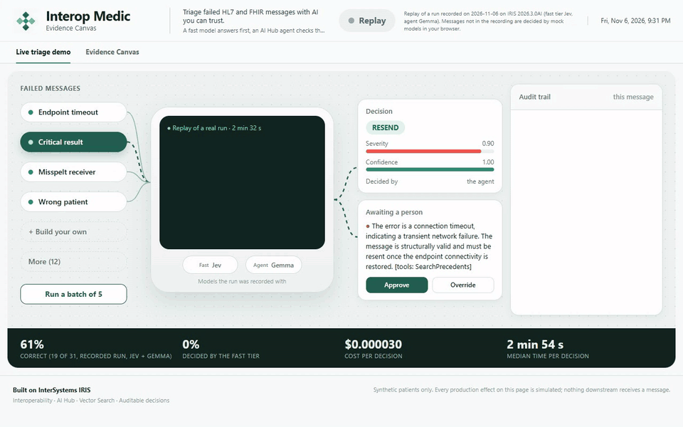
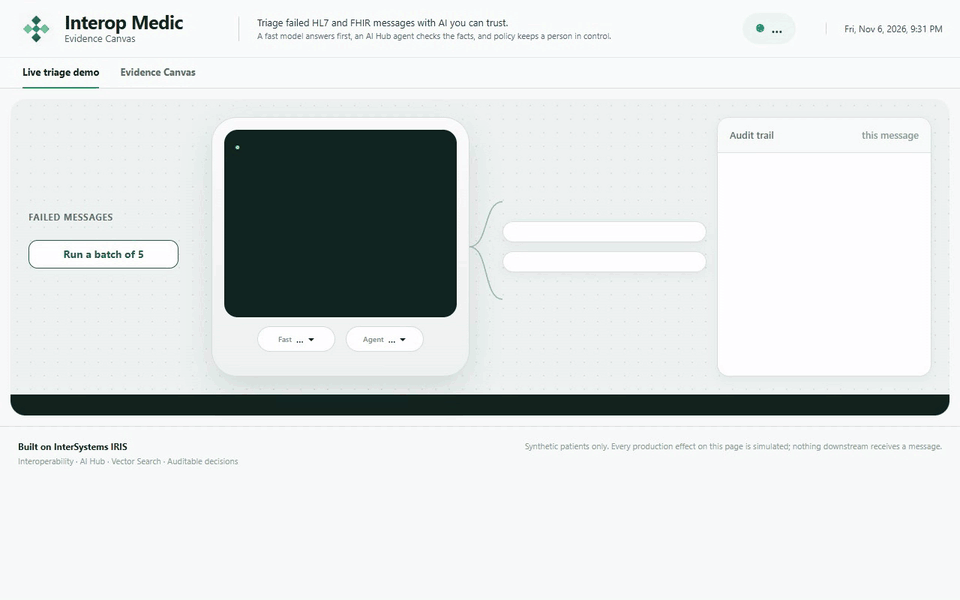

# Interop Medic

An AI agent that triages failed HL7 v2 and FHIR messages in InterSystems IRIS Interoperability.
For each errored or suspended message it decides one of **resend**, **fix and resend**,
**reroute**, **quarantine** or **escalate**, with a confidence, a severity, a rationale and a
proposed fix. A fast decision model answers first, an AI Hub agent checks the facts with read-only
tools, a deterministic policy decides what may run alone, and a person reviews the rest.

## See it first

Both clips are the page replaying the bundled recording (Jev + Gemma), sped up.

A critical result during an outage. Gemma answers resend at full confidence, and the severity limit
holds it for a person anyway:



A batch of five, scored against the expected actions:



## For judges: two minutes

**1. Load the AI Hub image.** Download build 154 (`irishealth-community-2026.3.0AI.154.0-docker.tar.gz`)
from the [EAP portal](https://evaluation.intersystems.com/Eval/early-access/AIHub), "AI Hub" program:

```bash
docker image load -i irishealth-community-2026.3.0AI.154.0-docker.tar.gz
docker images
docker tag <loaded image name> irishealth-community:2026.3.0AI.154.0
```

**2. Start it.** `.env` is optional: with none, every model runs from keys you paste into the page.

```bash
git clone https://github.com/Fruitkwan/interop-medic-ai-hub.git
cd interop-medic-ai-hub
cp .env.example .env
IRIS_IMAGE=irishealth-community:2026.3.0AI.154.0 docker compose up -d --build
```

**3. Check it works.**

```bash
curl http://localhost:52773/medic/api/health
docker exec interop-medic iris session IRIS -U USER "##class(Medic.Setup).Doctor()"
```

`health` answers with `"aihub":true` on the right image. If ports 52773 or 1972 are taken, set
`MEDIC_WEB_PORT` and `MEDIC_SS_PORT`.

**4. Open** http://localhost:52773/medic/index.html (no sign-in; the Management Portal uses
`_SYSTEM` / `SYS`, or your `IRIS_PASSWORD`).

**5. Pick your models.** The **Fast** and **Agent** menus under the screen list every model (see
[Models](#models)). Use **API keys** to paste your own key for any of them, or put it in `.env`.
No key is needed for **Mock**, which runs offline.

**6. What to click:** pick **Critical result**, watch the trace build, then **Approve**. Then
**Run a batch of 5**, and finally **+ Build your own** to write a message of your own. The strip at
the bottom shows a recorded run until you run something, then this session's numbers.

**The labels:**

- **Live** means the page is talking to the running IRIS production.
- **Replay of a run** means it is replaying a bundle (`web/data/bundle.json`) recorded with real
  models; **Replay (mock models)** is the same for a bundle recorded on the mocks.
- **Mock** means the models are the offline mocks.
- Downstream effects (resend, reroute and so on) are marked "(simulated)": nothing downstream exists.

**Good to know:**

- **Safety:** the `/medic` web applications are unauthenticated. Do not expose port 52773 to a
  network without HTTPS and a look at [Judges' own keys](#judges-own-keys).
- **The demo production** runs `Medic.Triage` with `DryRun` off, so auto-applied decisions show up on
  the page; every effect is still simulated. To turn it back on, set the `DryRun` setting of
  Medic.Triage (Policy group) in the production configuration.
- **Without a server:** `uv run python -m http.server -d web 8090` serves the page alone, replaying
  the bundle. The `Deploy web/ to GitHub Pages` workflow (`.github/workflows/pages.yml`) publishes
  that copy; it is manual (`workflow_dispatch`) and runs the page tests first.
- **Re-recording the bundle:**

  ```bash
  uv run python eval/record.py --batches 3 --fast Jev --agent Gemini --out web/data/bundle.json
  ```

  Add `--timeout 900` for a local model on a CPU. If any case is skipped (for example on a quota
  error), the recorder leaves the bundle untouched, writes `bundle.partial.json` next to it and exits
  nonzero; `--allow-partial` overrides that.

> **Status:** the bundled recording is a real Jev + Gemma run of 16 scenarios and 15 random cases on
> build 154, from an empty precedent store: 19 of 31 decisions matched the expected action, and every
> case went on to the agent (low confidence, high severity or a reroute). The policy applied 3 on
> its own and held 28 for a person, 17 of them correct. Eight wrong decisions were confident enough
> to run alone; the severity limit held 7, including two critical results and a patient mismatch.
> One got through: an unknown receiver "fixed" instead of rerouted, rated severity 0.5. The limit
> relies on the model's own severity score, and 0.9 and 0.6 are defaults, not values fitted for Gemma.
> Keep `DryRun` on (the class default) until you have fitted them for your model. Gemma ran on a CPU,
> hence about 3 minutes a decision; hosted agents took 15 to 36 seconds in our tests. Scores vary
> between runs: the previous clean run scored 23 of 31. Everything also runs offline on mocks.

## How it works

```
Medic.DemoFeed ──> Medic.Triage (BPL) ──> Medic.Agent ──> Medic.FastTier
 (case files)       policy + dry run       │  1. ask the fast tier (a decision model)
                         │                 │  2. confident & low severity? accept it
                         │                 └  3. otherwise run the tool-using agent
                         └─ held for a person ──> Medic.Review ──> Medic.Reviewers
                                                  (Workflow task in the IRIS Workflow inbox)
```

Every decision goes through `Medic.Agent`. The fast tier is the agent's first step, not a bypass.
When it is confident and the case is low-stakes, the agent stops there; reroutes always go to the
full agent, because only its tools can name a target. Otherwise the agent runs with the fast
answer as a hint. `Medic.Policy.AutoApply` then decides whether the decision can be applied
without a person. `DryRun` is covered in the judges section above and in the table below.

| Setting | Item | Default |
|---|---|---|
| `ProviderClass` | Medic.FastTier | `MEDIC_FAST_PROVIDER`, else `Medic.Provider.JevMock` |
| `ProviderClass` | Medic.Agent | `MEDIC_AGENT_PROVIDER`, else `Medic.Provider.AgentMock` |
| `ReviewTarget` | Medic.Triage | `Medic.Review`; blank creates no Workflow tasks |
| `FastConfidence`, `FastSeverityCeiling` | Medic.Agent | 0.85, 0.6 |
| `AutoApplyThreshold`, `AutoApplyMaxSeverity`, `DryRun` | Medic.Triage | 0.9, 0.6, off in the demo production (on in the class) |

### Held decisions become Workflow tasks

When the policy holds a decision for a person, `Medic.Triage` also sends it to `Medic.Review`,
which opens an IRIS **Workflow Engine** task for the role `Medic.Reviewers` (the
`EnsLib.Workflow.Operation` item of that name; `_SYSTEM`, `SuperUser` and `Admin` are members).
The task shows the proposed action, confidence, severity, rationale and fix, with the choices
**Approve**, **Escalate** and **Quarantine**. Answer it in the Workflow inbox
(`http://localhost:52773/csp/user/_DeepSee.UserPortal.Workflow.zen`, signed in as one of those
accounts) and the answer goes through the same code as the
web page's buttons: the trace gets a person step, the audit trail a row and the precedent store
the case. Whoever decides first wins; deciding on the page completes the task.

### Every LLM call in the Visual Trace (Community idea DPI-I-689)

This entry implements [DPI-I-689](https://ideas.intersystems.com/ideas/DPI-I-689), *Use InterSystems
Interoperability as a Traceability tool for GenAI LLM pipelines*. Each model call is a message in
the production, so the Visual Trace of one failed message holds the whole pipeline: the fast
model's call, the gate, the agent's run with each tool call, the policy, and a person's review.

To see it: triage a scenario on the web page (e.g. *Critical result*), then open Interoperability >
Message Viewer, pick the session's newest `Medic.Triage` row and click **Trace**. Click the
`Medic.Msg.Decision` response of `Medic.Agent` (and of `Medic.FastTier`). Its body shows:

| Field | What it holds |
|---|---|
| `Model`, `Provider` | the model id and the provider class that ran it |
| `InputTokens`, `OutputTokens`, `CostUSD`, `LatencyMs` | usage, estimated cost and duration |
| `Prompt`, `Completion` | the user turn sent to the agent and the model's raw reply (the fast tier has no prompt text: its reply is the typed answers) |
| `ToolCalls` | each agent tool call in order, with its arguments, result (first 1,000 characters), duration and status |
| `TraceJSON` | the steps the web page draws (fast tier, gate, tools, agent, policy, person) |

The same session also holds the `Medic.Msg.ReviewRequest` and the Workflow task when a person
has to look. Nothing leaves IRIS: prompts and patient data stay in the production, and the trace
leads straight to an action (approve, override, resend). The vector precedent store
(`Medic.Data.Precedent`, IRIS Vector Search) is part of the same trace: `SearchPrecedents` calls
appear in `ToolCalls` with the case they found.

## Run it

You need Docker and [uv](https://docs.astral.sh/uv/). The Python scripts use only the standard
library; `uv sync` creates `.venv` with a matching Python.

```bash
uv sync
cp .env.example .env            # optional: your own IRIS password, fast-tier settings
uv run python dataset/generate.py --synthea dataset/synthea --cases-dir data/cases
docker compose up -d --build
uv run python dataset/feed.py --count 20 --rate 1
```

`feed.py` drips a shuffled mix of failed messages into the production. Use `--only
outage_critical_result,patient_mismatch` to show the hard cases.

Open the Management Portal at http://localhost:52773/csp/user/EnsPortal.ProductionConfig.zen and
look at the Visual Trace for each message. If ports 52773 or 1972 are taken, set `MEDIC_WEB_PORT`
and `MEDIC_SS_PORT`.

**Signing in.** Use `_SYSTEM` with the `IRIS_PASSWORD` from `.env`, or `SYS` if none is set.

- **No change-password prompt:** `_SYSTEM`, `SuperUser` and `Admin` are never forced to change
  their password.
- **When `IRIS_PASSWORD` is applied:** the first time the container starts, and again only after you
  change it in `.env`. A password changed in the portal survives restarts.
- **Recreated containers:** recreating the container (`docker compose down`, or a rebuild) starts
  again from the image.

**Readiness report.** To check the production, providers, routing table, mounts and accounts:

```bash
docker exec interop-medic iris session IRIS -U USER "##class(Medic.Setup).Doctor()"
```

### With or without AI Hub

The steps above run the AI Hub Early Access build, which this entry targets. Without `IRIS_IMAGE`,
the default community image has no AI Hub: the production, the page and the fast tier still work,
and the agent tier offers only Mock.

### Agent tier: the AI Hub agent

`Medic.AIHub.TriageAgent` is an AI Hub `%AI.Agent`. Its system prompt sets out the five actions
and the safety rules, and it must answer with one JSON decision. Its tools, in
`Medic.AIHub.ToolSet`, are all read-only:

- **`ValidateHL7`:** parses the message and checks its structure.
- **`GetRoutingRule` and `ClosestRoute`:** look up the routing table, including the closest match
  for a misspelt receiver.
- **`CheckEndpoint`:** reads a target's queue depth.

Two policies sit on the agent's tool manager:

- **`Medic.AIHub.ReadOnlyPolicy`** allows only those tools. The agent can read, but it never resends
  or edits anything. Applying a decision stays with `Medic.Policy.AutoApply` or a person.
- **`Medic.AIHub.ToolTrace`** records each tool call. The decision's rationale lists the tools that
  ran, and token use becomes the decision's cost.

`Medic.Provider.AIHubAgent` runs the agent once per message, with the fast tier's verdict as a
hint, and checks the reply. A reply with no JSON or an unknown action is rejected. A reroute with
no target becomes an escalation. Without AI Hub, or on any agent error, the case escalates with
zero confidence rather than failing.

The AI Hub classes are in `src-aihub/` and are compiled only when the image has `%AI.Agent`. The
default community image skips them, and the mock agent is used.

To make a real agent the production's default (for the demo feed and `eval/run.py`, which do not
go through the page's menus), set it in `.env`:

```bash
MEDIC_AGENT_PROVIDER=Medic.Provider.AIHubAgent
AIHUB_PROVIDER=gemini
AIHUB_MODEL=gemini-3.5-flash
AIHUB_API_KEY=<key>
```

## Models

Both tiers are chosen from the menus on the page. Each browser tab keeps its own choice, so people
sharing a server never switch models for each other.

### Fast tier: decision models

The fast tier answers three typed questions in one call: the action (a choice), the severity (a
score) and whether acting could attach data to the wrong patient (a yes/no probability). If that
wrong-patient probability is 0.7 or higher, the decision is forced to escalate. If the model is
down or replies badly, the case goes to the agent instead of failing.

| Menu | Model | How it is called | What it needs |
|---|---|---|---|
| **Mock** | `Medic.Provider.JevMock` | in-process | nothing |
| **Jev** | TypeSafe Jev, hosted | `POST /v1/systemone` | `SYSTEMONE_BASE_URL`, `SYSTEMONE_API_KEY`, `SYSTEMONE_MODEL` |
| **Nimble v3** | `nimble-v3`, local | Ollama's `POST /v1/systemone` | `OLLAMA_BASE_URL` |
| **Mercury Decide** | Inception `mercury-decide` | `POST /v1/decisions` (same request as System One) | `INCEPTION_API_KEY` |
| **Mercury 2.5** | Inception `mercury-2.5` | `chat/completions`, JSON mode | `INCEPTION_API_KEY` |
| **Laya** (optional) | Laya, open weights | `POST /v1/systemone` | `LAYA_BASE_URL` |

`Medic.Provider.SystemOne` handles every System One style API, with the path in the `Endpoint`
setting of `Medic.FastTier`. `Medic.Provider.ChatFast` asks a chat model the same three questions and
applies the same guardrail. Hosted fast models are listed in `MEDIC_FAST_MODELS`; a model id
containing `decide` uses the decisions API, any other a chat model:

```bash
MEDIC_FAST_MODELS=Mercury Decide=inception:mercury-decide,Mercury 2.5=inception:mercury-2.5
```

A 429 from a hosted model is retried once, after its `Retry-After` (at most 5 s); then the case goes
to the agent. Confidence from different models is not comparable, so re-run the eval after
switching: the auto-apply threshold is fitted per model.

To make one the production's default (for the demo feed and `eval/run.py`), set it in `.env`:

| Default | `.env` |
|---|---|
| Mock (offline) | nothing |
| Jev (hosted) | `MEDIC_FAST_PROVIDER=Medic.Provider.SystemOne`<br>`SYSTEMONE_BASE_URL=https://api.typesafe.ai`<br>`SYSTEMONE_API_KEY=...`<br>`SYSTEMONE_MODEL=jev-latest` (required)<br>`SYSTEMONE_PRICE_PER_MTOK=0.042` |
| Local Laya (`laya-serve`, or `ollaya` on 11435) | `MEDIC_FAST_PROVIDER=Medic.Provider.SystemOne`<br>`SYSTEMONE_BASE_URL=http://host.docker.internal:8000`<br>`SYSTEMONE_PRICE_PER_MTOK=0` |

`SYSTEMONE_MODEL` picks a Laya checkpoint (`english`, `multilingual`, `typed-decisions`). The same
values can be set on `Medic.FastTier` in the Management Portal, with the key stored as
Interoperability credentials; portal settings take precedence over env vars. Run Laya locally with
`pip install "laya[serve]"` then `laya-serve`. To check the plumbing without a model, run
`uv run python eval/fake_systemone.py` and point `SYSTEMONE_BASE_URL` at
`http://host.docker.internal:8765`.

### Agent: AI Hub models

Every agent model runs through AI Hub's `%AI.Agent` with the same read-only tools.

| Menu | Provider and model | Key | Run on build 154 |
|---|---|---|---|
| **Mock** | `Medic.Provider.AgentMock` | none | yes |
| **Gemini** | `gemini:gemini-3.5-flash` | `GEMINI_API_KEY` (or `GOOGLE_API_KEY`) | yes |
| **Mercury 2.5** | `inception:mercury-2.5` | `INCEPTION_API_KEY` | yes |
| **Gemma** | `ollama:gemma4`, local | none; `OLLAMA_BASE_URL` | yes (recorded run) |
| **Qwen** | `ollama:qwen3.8`, local | none; `OLLAMA_BASE_URL` | did not finish on a CPU in 15 minutes; needs a GPU |
| **Claude** | `anthropic:claude-sonnet-5-5` | `ANTHROPIC_API_KEY` | reached Anthropic; no full run without a key |
| **ChatGPT** | `openai:gpt-5.4` | `OPENAI_API_KEY` | not yet, no key |
| **Grok** | `xai:grok-4.5` | `XAI_API_KEY` | not yet, no key |

InterSystems lists OpenAI, Anthropic, Gemini and Bedrock as supported on this build, and xAI,
OpenRouter and Ollama as experimental. Inception runs through AI Hub's OpenAI-compatible path.

These lists are the defaults in `docker-compose.yml`. Set `MEDIC_AGENT_MODELS` (or
`MEDIC_FAST_MODELS`) in `.env` to replace one. Each entry is `Label=provider:model`; a blank model
means the provider's default, and the providers are those of
`##class(%AI.Provider).%GetProviders()`.

- **OpenRouter:** set `OPENROUTER_API_KEY` and add entries such as
  `Kimi=openrouter:moonshotai/kimi-k2` (the model is OpenRouter's slug).
- **Any other OpenAI-compatible API:** use a name AI Hub does not know, with `<NAME>_BASE_URL` and
  `<NAME>_API_KEY`, as `inception` does with `INCEPTION_BASE_URL=https://api.inceptionlabs.ai/v1/`.
- **Local Ollama models:** use the provider `ollama`, with `OLLAMA_BASE_URL` and no key.

The container reads every `.env` variable, so new keys need no change to `docker-compose.yml`.

### Keys

A listed model with no key stays on the menu, greyed out, until it has one. Keys come from, in order:

1. the visitor's own key, typed into the page ([below](#judges-own-keys));
2. IRIS Interoperability credentials named `Medic.<provider>` (e.g. `Medic.anthropic`, key in the
   Password field);
3. `<PROVIDER>_API_KEY` in `.env`, or the variable AI Hub names for that provider (`GOOGLE_API_KEY`
   for gemini);
4. `AIHUB_API_KEY`, when the provider is `AIHUB_PROVIDER`.

Keys never go into host settings. Cost tracking uses `SYSTEMONE_PRICE_PER_MTOK` on the fast tier
and one `AIHUB_PRICE_*` pair for all agent models.

### Judges' own keys

The page's **API keys** button lets each visitor paste their own key for any hosted model the
server lists. A greyed-out model turns on once its provider has a key, and a visitor's key replaces
the server's for their calls.

- The key stays in that browser tab (`sessionStorage`); closing the tab forgets it.
- Each triage sends only the keys its chosen models need. The server keeps them in
  `^IRIS.Temp.MedicKeys` (IRISTEMP: never journaled, cleared on restart) under a one-time token for
  that request only, and drops them when it ends. Messages carry the token, never the key, and any
  key a provider echoes in an error is replaced with `***` before the decision is stored.
- Each tab sends its model labels with every triage. `POST /models` still sets the server's default.
- The browser can choose a model and send a key, never a URL: endpoints come from the server's
  configuration only.

On a shared server (e.g. Azure), serve the page over HTTPS only (Container Apps or App Service
terminate TLS for you), or keys cross the network in clear text. The API has no login, so anyone
with the URL can also spend the keys in the server's `.env`: on a public host, leave hosted keys out
of `.env` and let judges bring their own, or put the app behind authentication.

### Local models with Ollama

Ollama serves both tiers on your own machine, with no API keys. Pull the models, then set:

```bash
OLLAMA_BASE_URL=http://host.docker.internal:11434
OLLAMA_FAST_MODEL=nimble-v3
```

- **Fast tier:** a decision model such as `nimble-v3` answers Ollama's `POST /v1/systemone`, the same
  API as Jev. The menu shows it by name.
- **Agent:** any tool-calling chat model, listed as `ollama:<model>`, runs through AI Hub's `openai`
  provider pointed at Ollama's `/v1`.

On a CPU-only machine a call can take minutes: Gemma took about 3 minutes a decision here.
`qwen3.8` (27B) needs a GPU: on a CPU it had not finished when the web gateway gave up at 900 s
(`OLLAMA_TIMEOUT` is 600 s per model call by default, and a run makes several). The single
`Medic.Agent` job stays busy until the run ends, so other messages wait behind it; restart the
container to clear one that is stuck.

### Web page and REST API

The image serves a static page at `http://localhost:52773/medic/index.html` (this IRIS build has no default-page setting, so the bare `/medic/` is a 404) and a same-origin REST API at `/medic/api` (health, scenarios, random cases, triage, approve/override, models). Both web applications are unauthenticated with role `%All`: see [Judges' own keys](#judges-own-keys) before exposing the container to a network. API tests: `uv run python -m unittest tests/test_api.py -v`.

## Eval

```bash
uv run python eval/run.py
```

This sends all 450 cases through the running production twice: once through the full pipeline
and once to the fast tier alone, as a comparison. Results go to `data/results/<tag>/`, where the
tag defaults to the fast-tier provider (`jevmock`, `systemone`, ...) or comes from `--tag laya-local`.
That way runs with different models sit side by side. The report shows accuracy per corruption type, which tier decided,
latency and estimated cost, and an **auto-apply threshold with a guarantee**:

- The threshold is chosen on the calibration split by Learn-then-Test with a Bonferroni
  correction over a fixed grid, using a Clopper-Pearson bound.
- With probability at least 1 − δ (default 90%), auto-applied decisions are wrong at most α of
  the time.
- The threshold is then checked on the held-out test split.
- Escalations are never auto-applied, and neither is anything at or above `AutoApplyMaxSeverity`.

With the mock providers the pipeline scores 100% and the mock fast tier alone 64.7%, because the
mock fast tier can't see context: critical results during outages, ambiguous dates, and receivers
that don't resolve to a route. These numbers only show the harness works, since the mocks were
written knowing the labels. Real numbers come from re-running with real models on both tiers.

Tests:

```bash
uv run python -m unittest eval/test_score.py eval/test_record.py dataset/test_generate.py tests/test_api.py
node --test "web/tests/*.test.mjs"
docker exec -i interop-medic iris session IRIS -U USER <<< 'set ^UnitTestRoot="/tmp" do ##class(%UnitTest.Manager).DebugRunTestCase("","Medic.Test.SystemOne","","") do ##class(%UnitTest.Manager).DebugRunTestCase("","Medic.Test.AIHubAgent","","") do ##class(%UnitTest.Manager).DebugRunTestCase("","Medic.Test.Models","","") do ##class(%UnitTest.Manager).DebugRunTestCase("","Medic.Test.Actions","","") do ##class(%UnitTest.Manager).DebugRunTestCase("","Medic.Test.Trace","","") do ##class(%UnitTest.Manager).DebugRunTestCase("","Medic.Test.Policy","","") do ##class(%UnitTest.Manager).DebugRunTestCase("","Medic.Test.Review","","")'
```

## Dataset

`dataset/generate.py` writes 16 corruption types × N synthetic cases (reroutes weighted 3×), each
with a known correct action. With `--synthea dataset/synthea`, patients and lab results come from
[Synthea](https://github.com/synthetichealth/synthea), so names, ages and values look realistic.

- **Patients:** 300 Synthea patients.
- **Lab results:** their real potassium, sodium, glucose, haemoglobin, calcium, urea and chloride
  results.
- **Critical results:** Synthea values are almost all in range, so critical results are derived by
  pushing a real result past its critical limit.
- **The committed sample:** `dataset/synthea` is about 220 KB and keeps only ID, birth date, name and
  sex, plus lab results. To rebuild it from a full Synthea CSV export, run
  `uv run python dataset/synthea_sample.py --src <export>/csv`.
- **Without `--synthea`:** the generator uses its own made-up patients. Some cases share an error message but need different actions depending on context. For
example, a timeout is normally a resend, but a critical potassium result stuck behind a 4-hour
outage needs a person. Cases are split by hash into `calibration` (60%) and `test` (40%).

```bash
uv run python -m unittest dataset/test_generate.py
```

All data is synthetic. Don't add real messages.

## License

MIT, see [LICENSE](LICENSE). The AI Hub Early Access image and model weights are not part of this repository.
