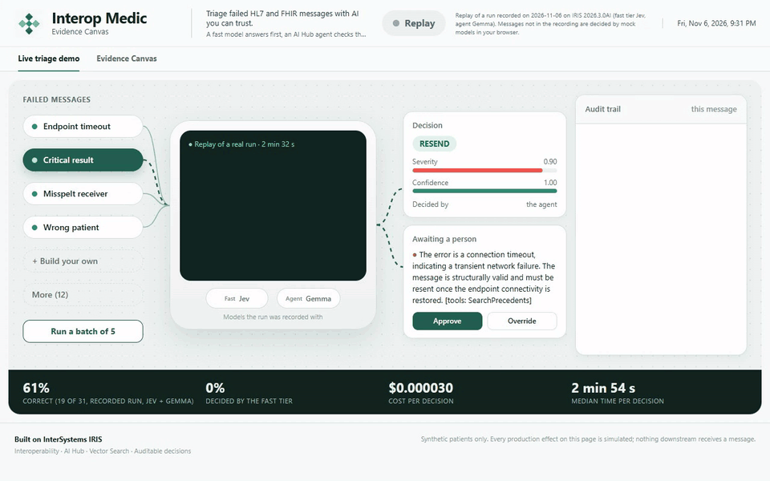

# Interop Medic: an AI agent that triages failed HL7 messages, and the recording that changed its policy

Every hospital integration engine has a queue of failed messages. Most of them only need a resend. A few are a critical lab result stuck behind an outage, or data about to reach the wrong patient. Telling those apart at 3 a.m. is the hard part.

Interop Medic does that triage inside InterSystems IRIS. It is my entry in the *AI Agents in Interoperability Workflows* contest, built on the AI Hub Early Access (build 154). For each failed HL7 v2 or FHIR message it decides one of five actions: resend, fix and resend, reroute, quarantine or escalate.

This article covers how it works, what the real recordings showed, and the policy change they forced.

**Try it in your browser, with nothing to install:** [replay of a recorded run](https://fruitkwan.github.io/interop-medic-ai-hub/)

**Code:** [GitHub](https://github.com/Fruitkwan/interop-medic-ai-hub) · **Video:** [ADD YOUTUBE LINK] · **Open Exchange:** [ADD OPEN EXCHANGE LINK]



## How it works

The whole pipeline is an ordinary Interoperability production:


1. **A fast decision model answers first.** Jev, Nimble or Inception's Mercury gives an action and a confidence.
2. **A gate checks that answer.** If the confidence is low or the severity is high, or the case is a reroute, it goes on to the agent.
3. **An AI Hub `%AI.Agent` checks the facts.** It searches past decisions with IRIS Vector Search, validates the HL7, looks up the routing table and reads the endpoint's queue. Every tool is read-only, and `Medic.AIHub.ReadOnlyPolicy` on the tool manager allows nothing else. The agent can look, but it can't change anything.
4. **A deterministic policy decides what may run alone.** This is plain ObjectScript with no model involved.
5. **A person reviews the rest.** A held decision becomes a task in the IRIS Workflow Engine. A reviewer can answer it in the Workflow inbox or on the web page. Whoever decides first wins, the audit trail records it, and the case joins the precedent store so the next similar failure can cite it.

## The Visual Trace is the LLM trace

Every model call is a message in the production, so I did not need an external tracing service. Open a session in the Message Viewer, click **Trace**, and the `Medic.Msg.Decision` response holds the model, the token counts, the estimated cost, the exact prompt, the raw reply and each tool call with its arguments, result and timing.

Prompts and patient data stay in IRIS, and the same trace shows the policy step and the person's review. This implements Community idea [DPI-I-689](https://ideas.intersystems.com/ideas/DPI-I-689), *Use InterSystems Interoperability as a Traceability tool for GenAI LLM pipelines*.

## What the recordings showed

To check the pipeline with real models, I recorded 31 labelled cases (16 fixed scenarios and 15 random ones) with Jev as the fast tier and Gemma running locally as the agent. All patients are synthetic, and every downstream effect is simulated. Three things surprised me.

**My tests had polluted the precedent store.** In the first full recording, 26 decisions cited precedents that came from my own API tests. The agent was learning from test data. I re-recorded on a fresh container with an empty store, and the bundled recording cites none of them.

**The policy trusted confidence too much.** That clean run scored 23 of 31, but the score was not the problem. The policy applied 23 decisions on its own, and five of those were wrong. One was a critical result, during a long endpoint outage, that Gemma simply resent. Three were ambiguous dates that it "fixed" by guessing.

The policy only asked two questions: is the confidence high enough, and is the action something other than escalate? A model can be sure and wrong, and nothing stopped it.

So I added a severity limit. Anything at or above it waits for a person, however confident the model is:

```objectscript
ClassMethod CanAutoApply(pDecision As Medic.Msg.Decision, pThreshold As %Numeric, pDryRun As %Boolean, pMaxSeverity As %Numeric = 0.6) As %Boolean
{
	quit:pDryRun 0
	quit:'$isobject(pDecision) 0
	quit:pDecision.Action="escalate" 0
	quit:(pDecision.Severity >= pMaxSeverity) 0
	quit (pDecision.Confidence >= pThreshold)
}
```

**The fast tier settled nothing.** In every recording all 31 cases went on to the agent, so I make no claim that it saves money yet. Its answer still reaches the agent as a hint.

## The result, including what it did not fix

I recorded again with the new rule:

| | Before the limit | With the limit |
|---|---|---|
| Correct decisions | 23 of 31 | 19 of 31 |
| Applied without a person | 23 | 3 |
| Wrong and applied without a person | 5 | 1 |
| Held for a person | 8 | 28 |

In the new run, eight wrong decisions were confident enough to run alone, and the limit held seven of them, including two critical results and a patient mismatch that Gemma wanted to "fix" at full confidence.

Three limits are worth stating plainly:

- **Accuracy did not improve.** The drop from 23 to 19 is Gemma varying between runs, because the rule acts after the model has answered. A small model on a CPU is not a good triage agent by itself. What changed is that nearly all of its mistakes now wait for a person.
- **One wrong decision still got through.** An unknown receiver was "fixed" instead of rerouted, and Gemma rated it severity 0.5. The limit relies on the model's own severity score.
- **Safety costs review time.** 17 of the 28 held decisions were correct, and a person now has to confirm them. The 0.9 and 0.6 limits are defaults, not fitted values. The eval harness in the repository can fit a threshold per model, and `DryRun` stays on by default in the class until you have done that.

The lesson I am keeping: an agent's confidence is an input to the decision about whether it may act. It should not be the decision.

## Any model, your own key

The fast tier offers Jev, Nimble, Mercury and Mercury Decide. The agent runs Gemini, Claude, ChatGPT, Grok and Mercury through AI Hub, or Gemma and Qwen locally through Ollama. OpenAI-compatible providers such as OpenRouter can be added through configuration.

Anyone running the container can paste their own key into the page. It stays in the browser tab, is sent with each triage, and the server drops it when that request ends. Everything also runs offline on mock models, with no key at all.

## A few things I learned on build 154

- **Tool arguments arrive as a JSON string**, so parse them before you log them.
- **A Workflow role is named after the `EnsLib.Workflow.Operation` item**, and the role and its users must exist before tasks can reach them.
- **Production jobs keep running the old code** after you compile in place, so restart the production or rebuild when a process class changes.

## Try it

The [replay](https://fruitkwan.github.io/interop-medic-ai-hub/) needs nothing installed. To run the real pipeline, load build 154 from the EAP portal, then:

```bash
git clone https://github.com/Fruitkwan/interop-medic-ai-hub.git
cd interop-medic-ai-hub
cp .env.example .env
IRIS_IMAGE=irishealth-community:2026.3.0AI.154.0 docker compose up -d --build
```

Then open http://localhost:52773/medic/index.html, pick **Critical result**, and watch the trace build.

I would like to hear how you would decide what an agent may do alone in your own productions. If you like the project, please vote for it, and try it with your own model.
